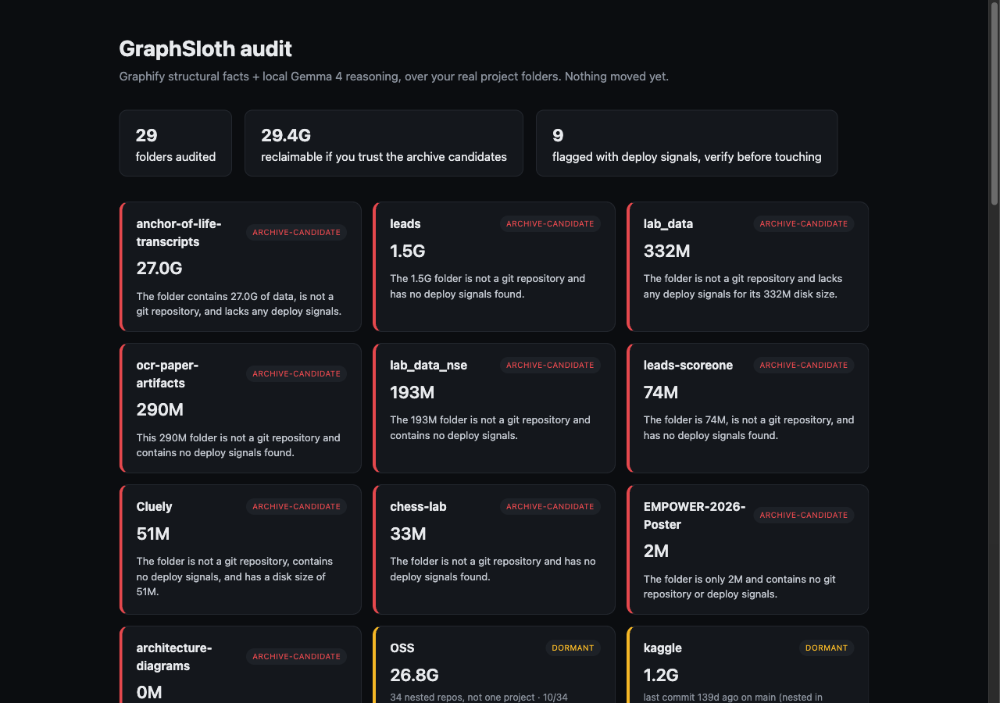

# GraphSloth

**[Live demo →](https://codersacademy006.github.io/graphsloth/)**

A lazy-friendly audit of your abandoned project folders. Built for the Hacktoberfest Open-Source AI Challenge: Week 3 ("Slow and Steady").

Most developers have a `~/Desktop/Project` folder full of things they built, half-finished, and never looked at again. Deciding what's safe to archive is tedious enough that nobody does it. GraphSloth does it for you, overnight, and cites real evidence instead of guessing.



Real run against the author's own Desktop: **29 folders audited, 10 flagged ARCHIVE-CANDIDATE (29.4G reclaimable), 16 ACTIVE, 3 DORMANT.** 9 of those were flagged with real deploy signals and kept out of the archive pile automatically, including a live e-commerce store and a production exam-scoring backend.

## How it works

For each top-level folder:

1. **Disk size** — `du -sk`.
2. **Git facts** — last commit age, branch, dirty state. Checked one level into subfolders too, for folders that *hold* a git repo rather than being one themselves (see "Caught lying to itself" below).
3. **Graphify structural extraction** — real tree-sitter AST parsing via [Graphify](https://github.com/Graphify-Labs/graphify), zero LLM cost: node count, edge count, most-referenced symbol.
4. **Deploy signals** — `vercel.json`, `.vercel`, `docker-compose.yml`, `render.yaml`, `fly.toml`, a live URL in the README, checked locally with no network calls.
5. **Gemma verdict** — a local model (`gemma4:12b-it-q4_K_M` via Ollama) reads those real facts and returns `ACTIVE` / `DORMANT` / `ARCHIVE-CANDIDATE` plus a one-sentence reason that must cite the actual numbers. No invented facts, no vibes.

Output is `report.html`: a single static page, sorted by reclaimable size.

## Caught lying to itself

All three of these were found by running GraphSloth on the author's own live, production folders, not in a test suite, and each was fixed the same day it was found.

**A live store flagged safe to archive.** Srijan Saree, a real e-commerce store with real orders, came back as `ARCHIVE-CANDIDATE`. The deploy-signal check only looked at a folder's top level; the store's actual code (and its `.vercel` config) sat one folder down. A shallow scan saw nothing and called it quiet. Fixed by checking one level into subfolders when the top level isn't a git repo itself — several real folders here (Srijan Saree, OSS, Trading, kaggle, Personal Site, JobCoachX) are a parent directory holding a repo, not a repo themselves.

**One busy repo almost spoke for 34.** OSS, 26.8G holding 34 separate git clones, was one busy clone away from being called `ACTIVE` as a whole. The first nested-repo fix above picked whichever single clone was touched most recently and judged the entire 26.8G folder by it. Only 10 of the 34 clones had actually moved in the last 30 days. Fixed by detecting a multi-repo container and reporting the real distribution (how many of how many, oldest and newest) instead of one point sample, with a code-level cap: a container with any stale repos among its recent ones is never allowed to come back `ACTIVE`.

**A raw exception almost shipped as a verdict.** A single Ollama timeout, right after a restart, nearly produced a report containing the literal text `[Gemma call failed after 3 attempts: timed out]` as a folder's "reason." Root cause: the model emits a chain-of-thought before its answer, and a complex multi-repo fact block pushed that past a 300-second timeout on CPU-only inference. Fixed two ways: the request now passes `think: false` and caps `num_predict`, cutting a call that used to hang indefinitely down to single-digit seconds, and every result is checked for that shape of raw error and retried before anything gets published.

## Known limitation: quiet isn't the same as abandoned

The verdict leans heavily on git commit age. A side project untouched for months is genuinely dormant, but a stable, deployed service you rarely need to touch (a live backend, a production site) can look just as "stale" by that same signal, even while it's serving real traffic right now.

The deploy-signal check exists for exactly this, and the result is a hard, code-level rule, not a hope that the model remembers: **a folder with any deploy signal can never come back as `ARCHIVE-CANDIDATE`**, it's capped at `DORMANT` and flagged with a visible "verify before touching" warning on its card, regardless of what the model's text says. This isn't proof of liveness — a repo can carry deploy config for a service that's long dead — so the flag means "check it yourself," not "it's definitely fine."

Nothing is ever auto-archived in bulk. `--apply` asks per folder, one at a time, and every `ARCHIVE-CANDIDATE` deserves a real look before you say yes, not a rubber stamp.

## Durability, via Temporal

The first plain-Python run (`declutter.py`) got killed mid-way through 29 folders by an OS memory-pressure reaper (Gemma sits at 8G resident, the machine ran low on RAM in the background), at folder 28 of 29, and recovering meant hand-parsing stderr logs back into results (`finish_run.py`).

`temporal_audit.py` runs the exact same per-folder audit as a Temporal workflow instead, with each folder's result as a durable activity:

```bash
python3 temporal_audit.py worker              # one terminal
python3 temporal_audit.py start                # another terminal, all folders
```

Proven live, not just claimed: started a 5-folder run, let 2 complete, `kill -9`'d the worker process mid-activity, confirmed via `temporal workflow describe` that the workflow was still alive on the server with its 2 completed results intact, restarted the worker, and watched it resume from folder 3 rather than starting over. `ta_workflow.py` holds only the deterministic workflow definition (Temporal's sandbox forbids filesystem/subprocess access there); `ta_activities.py` holds the actual I/O, imported only by the worker process.

## Why open matters here

- **Zero cost.** Graphify's extraction is local tree-sitter parsing, no API key. Gemma runs locally via Ollama. No cloud bill for auditing dozens of gigabytes.
- **Privacy.** Several of the audited folders are private client work. Nothing about their contents leaves the laptop.
- **Real evidence over vibes.** Most "clean up your projects" tools work off `mtime` alone. GraphSloth grounds the verdict in a real structural graph of the code, the same pattern that worked for [OneGraph](https://github.com/CodersAcademy006/onegraph) (the author's MLH Hack Day project the week before this one): an LLM reasoning over real graph facts beats an LLM guessing.

## Run it

```bash
python3 declutter.py                 # defaults to ~/Desktop/Project, writes report.html
python3 declutter.py --apply         # also offers to move ARCHIVE-CANDIDATE folders, asks per item
```

Requires `ollama` running locally with a Gemma model pulled, and the [`graphify`](https://github.com/Graphify-Labs/graphify) CLI on PATH. For the Temporal variant, also `pip install -r requirements.txt` in a venv and a local Temporal server (`temporal server start-dev`).

## Project layout

| File | What it is |
| --- | --- |
| `declutter.py` | The core pipeline: facts, Gemma verdict, report rendering |
| `temporal_audit.py`, `ta_workflow.py`, `ta_activities.py` | The same audit as a durable Temporal workflow |
| `finish_run.py` | One-off OOM recovery: rebuilds results from a partial run's log |
| `refix_nested.py` | Re-runs just the folders affected by the nested-repo fixes |
| `index.html` | This repo's landing page |

## Prize categories

Best Use of Gemma, Best Use of Temporal. Graphify is not an official Week 3 partner category, it's just the real open-source tool making the verdicts trustworthy instead of invented.

## License

MIT, see [LICENSE](LICENSE).
